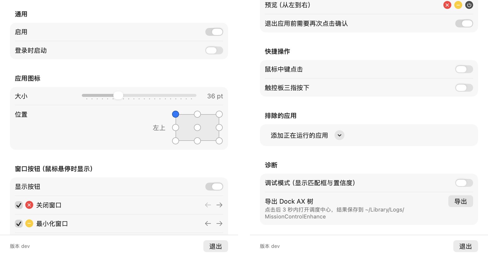

<p align="center">
  
</p>

<h1 align="center">MissionControlEnhance</h1>

<p align="center">
  给 macOS 调度中心的每个窗口缩略图加上应用图标和快捷操作按钮。
</p>

<p align="center">
  <a href="https://github.com/SlimeNull/MissionControlEnhance/releases/latest"></a>
  
  
</p>

<p align="center">
  
  <br>
  <sub>效果示意：图标与按钮由应用自身的绘制代码生成，窗口内容为占位图。</sub>
</p>

## 为什么需要它

调度中心只有开启「按应用程序将窗口分组」时才显示应用图标，但分组后同一应用的多个窗口挤在一起，很难分辨。关掉分组后窗口都摊开了，却没有图标，只能凭缩小的窗口内容猜它属于哪个应用。

MissionControlEnhance 是一个菜单栏小工具，它在**不分组**的调度中心上叠加一层：给每个缩略图标出所属应用，并让你不离开调度中心就能整理窗口。

## 功能

- **应用图标**：每个窗口缩略图上显示所属应用的图标，大小可调，位置可选四个角、四条边或正中间。
- **悬停按钮**：鼠标移到缩略图上时显示「关闭窗口」「最小化窗口」「退出应用」按钮。可以选择显示哪几个，也可以调整它们的左右顺序。
- **防误操作**：退出应用默认需要再点一次确认；按住 ⌥ 点击退出按钮为强制退出。
- **快捷操作**（默认关闭）：鼠标中键点击或触控板三指按下缩略图，直接关闭窗口、最小化或退出应用。
- **排除应用**：不想被标注的应用可以加入排除列表。
- **多显示器**：每块屏幕的调度中心都会叠加。
- **登录时启动**。
- **中英文界面**：跟随系统语言，中文系统中显示为「调度中心增强」。

## 安装

1. 从 [Releases](https://github.com/SlimeNull/MissionControlEnhance/releases/latest) 下载对应芯片的 DMG：
   - Apple Silicon（M 系列芯片）：`MissionControlEnhance-x.y.z-arm64.dmg`
   - Intel：`MissionControlEnhance-x.y.z-x86_64.dmg`
2. 打开 DMG，把 MissionControlEnhance 拖进「应用程序」。
3. 首次打开时，macOS 会提示无法验证开发者，点「完成」（较早的系统上是「取消」），不要点「移到废纸篓」。
4. 打开「系统设置 → 隐私与安全性」，在页面下方找到 MissionControlEnhance 的提示，点「仍要打开」，再确认一次。
5. 按提示在「系统设置 → 隐私与安全性 → 辅助功能」中允许 MissionControlEnhance。授权后无需重启应用，打开调度中心即可看到效果。

> [!NOTE]
> 应用没有经过 Apple 公证，所以第一次需要手动放行，之后就能正常打开，不需要在终端输入任何命令。
>
> 升级到新版本后，辅助功能里的旧授权会失效。如果升级后没有效果，请在辅助功能列表里删掉 MissionControlEnhance，再重新添加或重新授权。

### 权限

| 权限 | 用途 | 是否必需 |
|---|---|---|
| 辅助功能 | 读取调度中心缩略图的位置、关闭和最小化窗口、拦截按钮上的点击 | 必需 |
| 输入监控 | 读取触控板上的手指数，用于识别三指按下 | 仅在开启三指按下且检测不到手指时需要 |

应用不需要屏幕录制权限，不会读取窗口内容。

## 设置

点菜单栏图标 →「设置…」打开设置窗口。应用已在运行时，再次打开它也会直接弹出设置窗口。

<picture>
  <source media="(prefers-color-scheme: dark)" srcset="docs/images/settings-dark.png">
  
</picture>

如果某个缩略图没有图标或图标标错了，可以在设置的「诊断」中打开调试模式：每个缩略图会画出边框，绿色表示精确匹配到窗口，黄色表示只确定了应用，红色表示没有匹配上。「导出 Dock AX 树」可以导出调度中心的辅助功能结构，提交问题时附上它会很有帮助。

## 已知限制

- 只支持关闭「按应用程序将窗口分组」的调度中心。
- 暂不支持台前调度（Stage Manager）。
- 三指按下依赖私有框架 MultitouchSupport，系统更新后可能失效；失效时该选项自动禁用，不影响普通点击。
- 调度中心不提供窗口 ID，缩略图靠窗口标题和尺寸匹配。匹配不确定时，不会显示关闭和最小化按钮。

## 从源码构建

只需要 Command Line Tools，不需要 Xcode。

```bash
./scripts/build.sh        # 生成并签名 build/MissionControlEnhance.app
./scripts/build_dmg.sh    # 生成 build/MissionControlEnhance-<版本>-<架构>.dmg
```

两个脚本都支持以下环境变量：

| 变量 | 说明 |
|---|---|
| `ARCH` | `arm64` 或 `x86_64`，默认为本机架构 |
| `VERSION` | 覆盖版本号，例如 `1.0.0` |
| `CONFIG` | `release`（默认）或 `debug` |
| `SIGN_IDENTITY` | 签名身份。默认使用钥匙串中第一个开发证书，这样重新编译后不需要重新授权辅助功能；没有证书时使用 ad-hoc 签名（`-`） |

### 发布

推送 `v` 开头的标签后，GitHub Actions 会构建 Apple Silicon 和 Intel 两个 DMG，并自动创建 Release：

```bash
git tag v1.0.0
git push origin v1.0.0
```

带 `-` 的标签（如 `v1.1.0-beta.1`）会发布为预发布版本。
